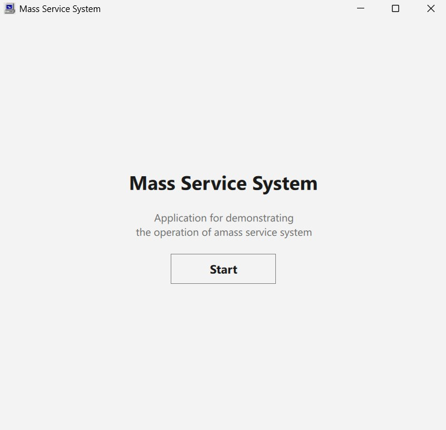
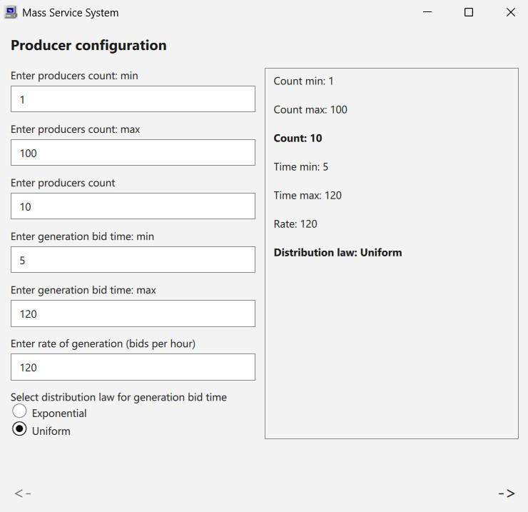
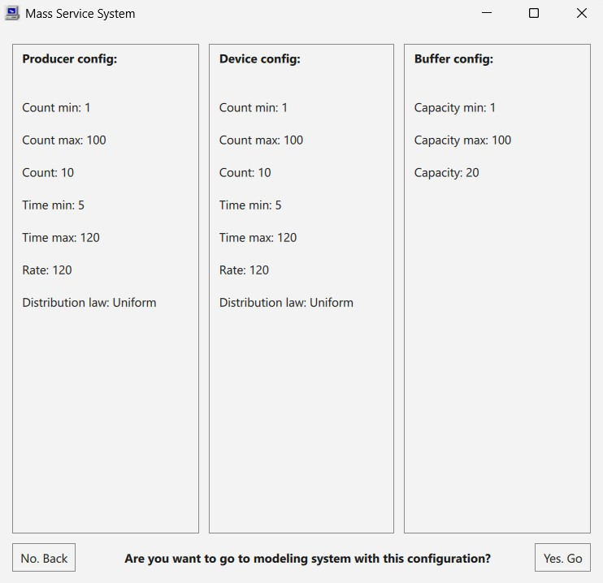
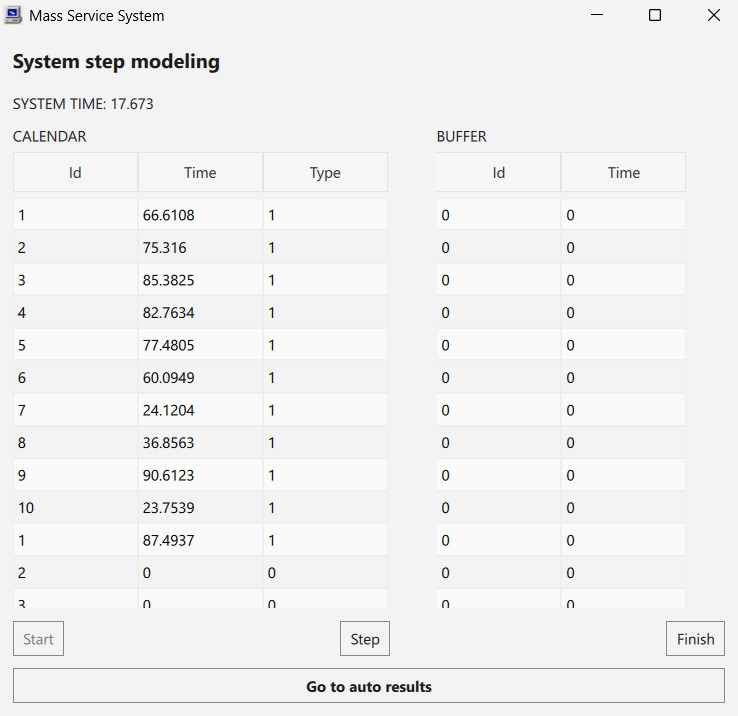
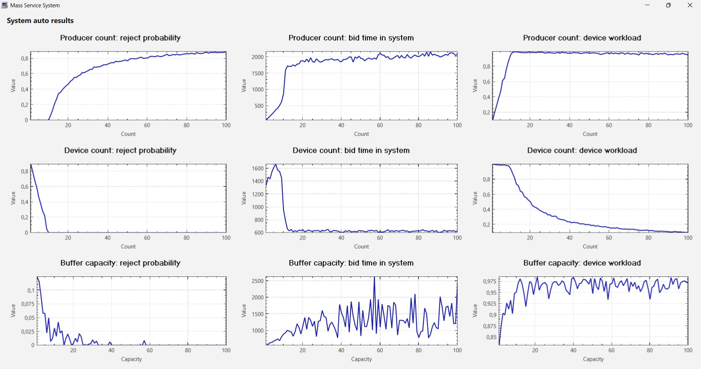

# Реализация системы массово обслуживания

# Mass Service System (СМО)

Приложение для моделирования и визуализации работы системы массового обслуживания (СМО). Позволяет настраивать параметры системы (количество источников и приборов, ёмкость буфера, законы распределения
времени генерации и обслуживания заявок), запускать симуляцию и строить графики зависимости ключевых метрик от параметров.

## Возможности

- **Настройка конфигурации** через графический интерфейс:
    - Количество источников заявок (`cnt_min`, `cnt_max`, `cnt`);
    - Количество приборов (`cnt_min`, `cnt_max`, `cnt`);
    - Ёмкость буфера (`cap_min`, `cap_max`, `cap`);
    - Закон распределения времени генерации и обслуживания (экспоненциальный или равномерный);
    - Интенсивность генерации / обслуживания (`rate_per_hour` для экспоненциального);
    - Границы времени (`time_min`, `time_max` для равномерного).
- **Имитационное моделирование (пошаговый режим)** - дискретно-событийная модель с календарём событий, пулами источников и приборов и буфером.
- **Автоматический анализ (автоматический режим)** - прогон системы с варьированием одного параметра (количество источников / приборов / ёмкость буфера) при фиксированных остальных.
- **Визуализация результатов** - графиков зависимостей метрик от изменяющихся параметров: вероятность отказа, среднее время в системе, средняя загрузка приборов.
- **Кроссплатформенность** - Windows / Linux / macOS (Qt 6).

## Архитектура

Проект разделен на 3 уровня:
- *backend/system*: сама СМО и все ее составляющие;
- *backend/gui*: элементы для соединения СМО и пользовательского графического интерфейса;
- *qml*: сам графический интерфейс.

### Backend/system

| Класс | Ответственность |
|---|---|
| `System` | Дискретно-событийная модель СМО. `start()`, `step()`, `finish()`. |
| `ProducerGang` | Пул источников, генерация заявок, статистика по отказам и времени заявки в системе, распределение времени между генерациями заявок. |
| `DeviceGang` | Пул приборов, выбор прибора, постановка заявки на обслуживание, дисциплина выбора прибора, распределение времени обслуживания. |
| `Buffer` | Буфер, дисциплины постановки и отказа. |
| `Calendar` | Календарь событий (синхронизирован с состоянием системы). |
| `distribution` | Функции генерации времени (`Exp`, `Uniform`). |

### Backend/gui

| Класс | Ответственность |
|---|---|
| `PDConfigController` | Используется для конфигурации источников и приборов, хранит введенные значения, реализуют для них `Q_PROPERTY` для QML |
| `BufferConfigController` | Используется для конфигурации буфера, аналогичен `PDConfigCOntroller`. |
| `CalendarTableModel` | Модель с ролями `Id`, `Time`, `Type`, хранит изменяющееся во время работы СМО состояние календаря событий. |
| `BufferTableModel` | Модель с ролями `Id`, `Time`, хранит изменяющееся во время работы СМО состояние буфера. |
| `AutoGraphsTableModel` | Модели с ролями `ProducerCnt / DeviceCnt / BufferCap`, `AvgRejectProb`, `AvgTimeInSystem`, `AvgWorkload`, хранят результаты автоматического режима работы системы|
| `SystemStepController` | Используется для пошагового режима, хранит и изменяет состояние системы, заполняет соответствущие модели. |
| `SystemAutoController` | Используется для автоматического режима, прогоняет систему с разными параметрыми, заполняет соответствущие модели. |
| `SystemController` | Хранит и управляет остальными контроллерами. |

### View (QML)

- **Страницы**:
    - Стартовая страница (`WelcomePage`);
    - Конфигурация пула источников (`ProducerConfigPage`);
    - Конфигурация пула приборов (`DeviceConfigPage`);
    - Конфигурация буфера (`BufferConfigPage`);
    - Подтверждение установленных конфигураций (`ConfirmConfigPage`);
    - Отображение работы СМО в пошаговом режиме, управление ее состоянием (`SystemStepPage`);
    - Отображение результатов работы СМО в автоматическом режиме в виде 9 графиков (`SystemAutoPage`).
- **Переиспользуемые компоненты** (`MssPDConfigPage`, `MssLabeledIntField`, `MssHeader`, `MssPassFooter`, `MssTableView`).
- **Модули QML**: `mss`, `styles`, `components` - через `qmldir` + `QML_IMPORT_PATH`.

### Графики: QCustomPlot

Для отрисовки графиков используется библиотека QCustomPlot и обертка `CustomPlotItem` для использования совместно с QML.

## Требования

- **Qt 6.8+** (проверено на Qt 6.9.3), модули:
    - `core`, `gui`, `qml`, `quick`, `widgets`, `printsupport`;
    - `Qt6::Quick`, `Qt6::QuickControls.Basic`, `Qt6::QuickLayouts`;
- **C++17** (или новее);
- **qmake** (проект собран на qmake).

## Сборка и запуск

```bash
# 1. Открыть проект в Qt Creator (project.pro) с Kit'ом Qt 6.8+
# 2. Build -> Run qmake
# 3. Build -> Rebuild
# 4. Запуск
```

## Screenshots

- Старт



- Пример конфигурации



- Подтверждение конфигурации



- Пошаговый режим



- Результаты автоматического режима


